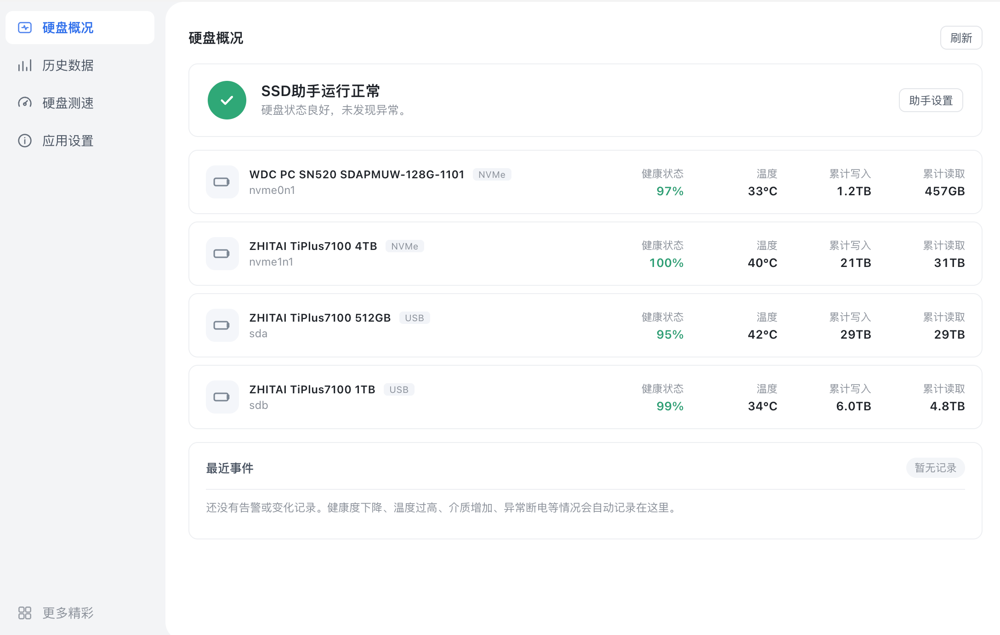

# SSD助手 · 铁威马 TOS 7

面向全闪（NVMe）NAS 的固态硬盘健康与寿命管理工具。自动采集每块 SSD 的读写总量、实时速率、
温度与健康度，解析 SMART 里的寿命消耗、通电时长、异常断电、介质错误等关键指标，并以日历
热力图呈现长期趋势——在硬盘真正损坏之前发现异常、安排备份与更换。

原生 deb 应用，按 TOS 7 规范打包：专用非 root 用户运行、只监听 Unix Socket 由平台网关代理、
不占用任何 TCP 端口。x86_64 与 aarch64 分别出包。



## 功能

- **硬盘概况**：健康度、温度、累计读写量、协议与容量一览，异常项单独标出
- **历史数据**：原始点位（默认留 90 天）+ 小时层（2 年）+ 天层（永久）三层存储，
  日历热力图看长期趋势，可导出 JSON
- **硬盘测速**：顺序读写实测，带实时仪表盘
- **告警与备份**：健康度下降、温度过高、介质错误等自动记录事件；历史库定时自动备份
- **应用设置**：采集间隔、保留策略、告警阈值、备份份数与上限

## 构建

不需要 TOS 设备，也不需要 `dpkg-deb`——`tools/mkdeb.py` 直接按 ar 归档格式生成标准 deb。

```bash
./build.sh              # 当前机器架构
./build.sh x86_64       # dist/ssdplus_x86_64.deb
./build.sh aarch64      # dist/ssdplus_aarch64.deb
./build.sh all          # 两个都出
```

后端是纯 Python 标准库，无第三方依赖；运行时依赖 `python3` 与 `smartmontools`（由 deb 的
`Depends` 保证）。

> 静态资源版本号用文件内容 sha1 前 8 位生成，不用应用版本号。TOS 的 nginx 对 `.js` / `.css`
> 给了 7 天强缓存，若用固定版本号当查询串，URL 永不变，浏览器会一直用旧文件。

## 安装

应用中心正常安装即可。手工验证：

```bash
sudo dpkg -i ssdplus_x86_64.deb
systemctl status ssdplus
sudo dpkg --purge ssdplus      # 卸载，连同 data/ 一起清空
```

安装后页面在 `/<appid>/`，接口由平台网关从 `/v2/proxy/ssdplus/` 转到 `/var/api/ssdplus.sock`。

**卸载会连数据一起删除**（审核要求卸载不留残余），且不可恢复。需要留历史就先用
「历史数据 → 导出」或「立即备份」把文件取走；只想清空数据不想卸载，用设置页的
「清空历史数据」。升级（`dpkg -i` 覆盖安装）不受影响，数据原样保留。

## 目录结构

```
app/                   后端（Python，标准库）与前端页面
├── server/            collector / sampler / store / alerts / bench / backup
└── www/               index.html + assets
packaging/             打进 deb 的 TOS 元数据
├── config.ini         应用清单（JSON 格式，扩展名是平台约定）
├── ssdplus.lang       应用名与描述（26 种语言）
├── ssdplus.env        systemd EnvironmentFile
├── bin/ssdplus        启动器（定位 python3，传固定参数）
├── images/icons/      应用图标（SVG）
├── init.d/            systemd 单元
└── DEBIAN/            control 与 postinst / prerm / postrm
overrides/www/assets/  前端适配层（构建时注入 webui.bz2）
├── tos.css            .app 顶部 40px 留白
└── tos.js             接口走平台代理 + 补 Csrf 头
tools/
├── mkdeb.py           不依赖 dpkg-deb 的 deb 打包器
├── tos_preview.py     本机模拟 /<appid>/ + /v2/proxy/ 的预览服务器
└── _frame.html        带 40px 标题栏的窗口外壳，用于核对顶部留白
```

安装后的布局（`/usr/local/ssdplus/`，物理位置 `/Volume<N>/@apps/ssdplus/`）：

```
config.ini  ssdplus.lang  ssdplus.env
bin/ssdplus             启动器
server/*.py             后端
webui.bz2               前端压缩包，安装时解压成 webui/
webui/                  平台 nginx 的站点根（/usr/www/ssdplus -> 这里）
images/icons/ssdplus.svg
init.d/ssdplus.service
data/                   运行期数据（不在包内，升级保留、卸载删除）
logs/                   日志目录（日志实际进 journal）
LICENSE  PRIVACY.md  THIRD-PARTY-NOTICES.md   许可与隐私原文（离线可读）
```

## 权限声明

| 权限 | 用途 |
|---|---|
| 网络：仅 Unix Socket `/var/api/ssdplus.sock` | 不占用任何 TCP 端口，全部流量由平台网关 `/v2/proxy/ssdplus/` 代理 |
| 文件系统：`/usr/local/ssdplus/data`、`/usr/local/ssdplus/logs` | 采样历史、配置、自动备份 |
| 设备：`/dev/nvme*`、`/dev/sd*`（只读） | 读 SMART（健康度、温度、寿命、读写总量） |
| 系统用户：`ssdplus`（主组 `allusers`，附加组 `disk`） | 专用非 root 用户运行 |
| 共享文件夹：无 | 不读写用户共享文件夹 |

**为什么需要 capability。** TOS 7 不允许应用以 root 运行，但读 SMART 必须能打开 root 属主的
设备节点并下发 ioctl。所以 service 里用三样最小能力替代 root：

```ini
AmbientCapabilities=CAP_DAC_READ_SEARCH CAP_SYS_ADMIN CAP_SYS_RAWIO
CapabilityBoundingSet=CAP_DAC_READ_SEARCH CAP_SYS_ADMIN CAP_SYS_RAWIO
```

- `CAP_DAC_READ_SEARCH`：打开 `/dev/nvme0`（`crw-------`）这类节点
- `CAP_SYS_ADMIN`：NVMe 与 SCSI 的 ioctl 透传（实测缺它 NVMe 直接 `status=4/NOPERMISSION`）
- `CAP_SYS_RAWIO`：SATA 的 ATA passthrough

进程身份依旧是 `ssdplus`，并配合 `NoNewPrivileges=true`、`ProtectSystem=strict`、
`CapabilityBoundingSet` 收窄，没有别的提权路径。

## 运行期文件清单

| 路径 | 用途 | 格式 | 生成时机 | 增长上限 | 生命周期 |
|---|---|---|---|---|---|
| `data/ssdplus.db` | 采样历史（原始/小时/天三层） | SQLite | 首次启动 | 由 `raw_keep_days`(90) / `hour_keep_days`(730) 分层保留控制，天层永久 | 持久，升级不删 |
| `data/ssdplus.db-wal`、`-shm` | SQLite WAL | 二进制 | 首次写入 | 随 checkpoint 回收 | 持久 |
| `data/etc/config.json` | 用户设置 | JSON | 首次启动 | < 100 KB | 持久 |
| `data/backup/*.db` | 自动/手动备份 | SQLite | 按间隔或用户点击 | 份数 `backup_keep`(3) + 总量 `backup_keep_mb`(500)，超出按时间淘汰 | 持久 |
| `data/.ssdplus_bench.tmp` | 测速临时文件 | 二进制 | 测速开始 | 单次 `bench_size_mb`(256 MB) | 测试结束立即删除；异常中断后下次覆盖 |
| `/var/api/ssdplus.sock` | 平台代理 socket | Unix socket | 启动时 | — | 启动前清残留，退出时删除 |

不写系统 `/tmp`，不写 `/etc`，不写包内静态文件。

## 几个与平台相关的地方

1. **NVMe 设备名**：TOS 7 把 NVMe 命名空间重命名成 `sdza / sdzb`（不是常见的 `nvme0n1`），
   对 `/dev/sdza` 读 SMART 会直接 `INQUIRY failed`。`collector.py` 会顺着 `/sys/block/<dev>`
   的真实路径找回 `nvme<N>` 控制器，用 `/dev/nvme<N>` 读 SMART，型号/序列号/固件也从控制器
   节点取。
2. **接口与鉴权**：页面由平台 nginx 从 `/usr/www/ssdplus` 发出，接口走 `/v2/proxy/ssdplus/`，
   每个请求必须同时带 `Cookie` 与 `X-Csrf-Token`。`assets/tos.js` 包了一层 `window.fetch`
   自动补齐并改写地址，业务代码零改动。
3. **会话失效**：网关回的是 `200 {"is_login":false}` 而不是 401。这里会刷新一次让平台自己
   走登录；若仍无会话则提示回桌面重新登录，不会刷成死循环。
4. **顶部 40px**：平台窗口的标题栏是浮在页面之上画的，会盖住应用顶栏。
   `overrides/www/assets/tos.css` 里就一条 `.app { padding-top: 40px; }`——全局是
   `border-box`，`height:100vh` 已含内边距，不用再算高度。
5. **systemd 细节**：应用用户的主组是 `allusers`（没有同名组，写 `Group=ssdplus` 会 216/GROUP）；
   不能用 `PrivateTmp`（`/var/api` 是 `/tmp/api` 的软链），不能用 `PrivateDevices`
   （要读设备节点）。
6. **开机自启**：`/etc/systemd/system/ssdplus.service` 必须是**实体文件**，不能软链到
   `/usr/local/ssdplus/init.d/`。应用目录在数据卷 `/Volume1` 上，开机早期卷还没挂载，
   systemd 解析软链会拿到 ENOENT（`Failed to open ...: No such file or directory`）后
   直接跳过该单元——表现就是重启后应用不自启。另外单元里用
   `After=tnas-mntdata.service` 排在数据卷挂载之后，并用
   `ExecStartPre` 等应用目录真正出现再拉起服务。

## 本地预览

```bash
# 1) 把设备上的应用 socket 转发到本机（或本地直接起一个后端）
ssh -N -L 19001:/var/api/ssdplus.sock <user>@<nas-ip> -p 9222

# 2) 起预览（会自动从 dist/*.deb 解出页面）
python3 tools/tos_preview.py --port 19002 --backend 127.0.0.1:19001
#    普通视图      http://127.0.0.1:19002/ssdplus/
#    带窗口标题栏  http://127.0.0.1:19002/ssdplus/_frame.html
```

预览服务器和真实网关一样：缺 `X-Csrf-Token` 就回 `is_login:false`，能顺便验证鉴权头。

## 自检

```bash
# 官方自检工具（Linux/TOS 上运行，macOS 不能原生执行）
TOSAppSelfTestingTool_amd64 -c dist/ssdplus_x86_64.deb   # -> check passed
```

## 发布

安装包通过 GitHub Release 发布，平台从 Release 拉取，不接受其他传包方式：

- Tag 形如 `v1.0.2`，同一个 Release 里放两个架构的包，**不放其他格式**
- **发新版要新建 Release，不要替换旧 Release 的资产**：平台在提交版本时会对包做 sha256
  基线，审核时重新下载比对，替换同一 tag 下的文件会让已提交的版本校验失败
- 资产命名：`ssdplus_x86_64.deb`、`ssdplus_aarch64.deb`（版本号从包内 `config.ini` 读，
  文件名里不需要带）
- 架构分开提交：开发者平台上 `x86_64` 与 `aarch64` 分别创建应用、分别选包

## 许可与第三方组件

本项目以 **MIT** 许可发布，全文见 [LICENSE](LICENSE)。后端、前端、图标与界面图形均为原创，
未包含任何第三方源码、脚本库、字体或图标素材；前端不加载任何 CDN 资源。

运行时依赖（`python3`、`smartmontools`）由系统提供、不随包分发，`smartctl` 仅以独立进程
方式调用命令行，不与本应用链接。逐项说明见 [THIRD-PARTY-NOTICES.md](THIRD-PARTY-NOTICES.md)。
包内同时放了一份在 `/usr/local/ssdplus/`，`/usr/share/doc/ssdplus/copyright` 按 Debian
规范归档（TOS 的 dpkg 只放行 doc 目录下的 copyright）。

## 隐私

**所有数据只留在本机**：不联网、不上传、无遥测、无账号。读取的是硬盘的 SMART 信息与
用户自己的设置，不涉及任何个人身份信息。

- 政策全文：[PRIVACY.md](PRIVACY.md)（包内 `/usr/local/ssdplus/PRIVACY.md`）
- 应用内入口：「应用设置」页底部 → 隐私政策
- 保留期限：60 秒明细 90 天（可调）、小时层 730 天、天层长期；备份按份数与容量轮转
- 删除渠道：设置页「清空历史数据」，或卸载（`postrm` 会删掉 data / logs / 配置 / 服务文件）

## 平台审核项对照（1.0.2）

| 审核项 | 本版本的处理 |
|---|---|
| C2 知识产权 | 补 `LICENSE`（MIT）、`THIRD-PARTY-NOTICES.md`、Debian `copyright`；`control` 加 `Homepage`；声明 smartmontools 为外部依赖、不随包分发 |
| C3 隐私政策缺失 | 新增 `PRIVACY.md`，同时放进包内与应用「应用设置」页底部入口 |
| C4 隐私政策不完整 | 政策覆盖保留期限、用户权利、安全措施、第三方共享、删除渠道五部分，中英双语 |
| C5 隐私政策不可访问 | 公开地址 `https://github.com/HUiTHEME/ssdplus_tos/blob/main/PRIVACY.md`，应用内可直接点开；包内另有离线副本 |
| F11 卸载后残留配置/数据 | `postrm` 在 `remove` / `purge` 下删除 `data`（数据库、设置、备份）与 `logs` |
| F4 卸载残留文件 | 同时删除 `/etc/systemd/system/<id>.service`、`/usr/lib/systemd/system/<id>.service`、wants 链接、`/usr/www/<id>` 软链、socket 与数据卷上的安装目录；`purge` 时连应用账号一起删 |

升级路径（`postrm upgrade`）不执行任何删除，只清残留 socket。

## 反馈

问题与建议请提 [Issues](https://github.com/HUiTHEME/ssdplus_tos/issues)。
